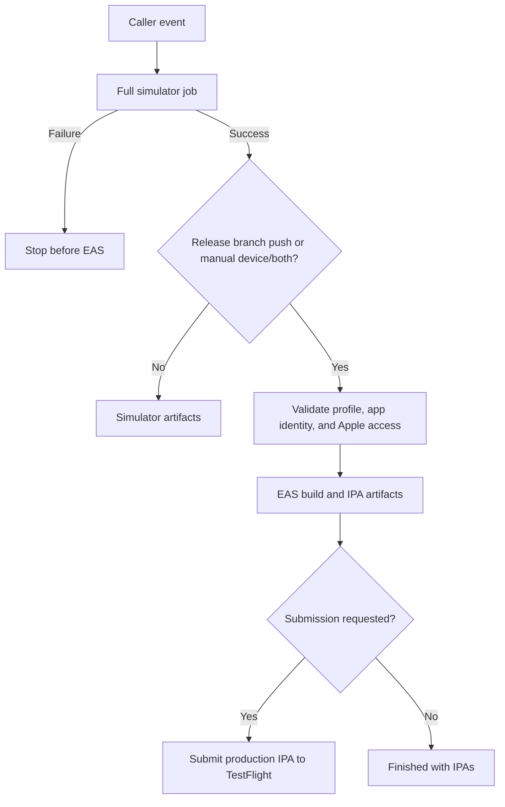

# Expo iOS Release Suite

<!-- markdownlint-configure-file { "MD013": { "line_length": 120, "tables": false, "code_blocks": false } } -->

Reusable GitHub Actions for **Expo simulator builds → EAS device builds → TestFlight**.
Keep the build implementation here and only app-specific triggers, IDs, and credentials in each app repository.

## Entry Points

| Entry point | Purpose | Runner |
| --- | --- | --- |
| `simulator/action.yml` | Full simulator compile, artifacts, diagnostics, and release-policy outputs | macOS with the selected Xcode installed |
| `eas/action.yml` | Explicit EAS profiles, progress monitoring, Apple preflight, and optional submission | Ubuntu with `timeout`, `jq`, `curl`, and `unzip` |
| `.github/workflows/ios-build.yml` | Two-job orchestration with a real simulator success dependency | macOS plus Ubuntu |

The two actions are independently reusable. A composite action cannot choose runners or express a cross-job
`needs` dependency, so the reusable workflow owns that orchestration.

## Use the Reusable Workflow

Create a thin workflow in the app repository:

```yaml
name: iOS Release
on:
  push:
    branches: ['**']
    tags: ['**']
  pull_request:
    branches: ['**']
  workflow_dispatch:
    inputs:
      target:
        type: choice
        default: simulator
        options: [simulator, device, both]
      profile:
        type: choice
        options: [not-selected, device, production, both]
      submit:
        type: boolean
        default: false
permissions:
  contents: read
jobs:
  ios:
    uses: Baneeishaque/expo-ios-release-suite/.github/workflows/ios-build.yml@v1.0.0
    with:
      target: ${{ inputs.target || 'simulator' }}
      profile: ${{ inputs.profile || '' }}
      submit: ${{ inputs.submit || false }}
      expected-bundle-id: dev.example.myapp
      expected-project-id: ${{ vars.EAS_PROJECT_ID }}
      expected-owner: ${{ vars.EXPO_OWNER }}
      asc-app-id: ${{ vars.ASC_APP_ID }}
    secrets:
      expo-token: ${{ secrets.EXPO_TOKEN }}
      asc-key-id: ${{ secrets.ASC_KEY_ID }}
      asc-issuer-id: ${{ secrets.ASC_ISSUER_ID }}
      asc-key: ${{ secrets.ASC_KEY }}
      public-env: ${{ secrets.IOS_PUBLIC_ENV }}
```

Replace `v1.0.0` with the release's full commit SHA for immutable caller pinning. The reusable workflow itself
pins its composite actions to a full implementation SHA, so its implementation does not float with `main` or a major tag.

## Trigger Policy

| Event | Full simulator compile | Simulator app upload | EAS | Submit |
| --- | --- | --- | --- | --- |
| Push to release branch, default `main` | Yes | Yes | Production | Yes |
| Other branch or tag push | Yes | Yes | No | No |
| PR update | Yes | Yes | No | No |
| Manual `target=simulator` | Yes | Yes | No | No |
| Manual `target=device` | Yes | No | Explicit profile choice | According to input |
| Manual `target=both` | Yes | Yes | Explicit profile choice | According to input |

Manual profile choices are `device`, `production`, and `both`. `both` builds device then production sequentially.
`profile=device, submit=true` is rejected before queuing EAS. Simulator success is required for every EAS path;
there is no no-op simulator shortcut. Set `release-branch: ''` to disable automatic EAS on pushes.



## Use the Composite Actions Directly

For custom orchestration, call `Baneeishaque/expo-ios-release-suite/simulator@v1.0.0` in a macOS job and
`Baneeishaque/expo-ios-release-suite/eas@v1.0.0` in an Ubuntu job with `needs: simulator`.
Pass the real `${{ needs.simulator.result }}` as `simulator-result` to the EAS action. The reusable workflow
is the recommended entry point when using the standard release policy.

Action implementation paths resolve from `GITHUB_ACTION_PATH`; `working-directory` resolves inside the caller's
`GITHUB_WORKSPACE`. Monorepo applications can therefore use `working-directory: apps/mobile` without copying scripts.

## Configuration

The action metadata files and workflow interface enumerate all inputs. Main defaults:

| Input | Default | Meaning |
| --- | --- | --- |
| `working-directory` | `.` | App with `package-lock.json` and Expo dependencies |
| `node-version` | `22` | App and EAS CLI runtime |
| `xcode-version` | `26.4.1` | Installed Xcode; defaults support Expo SDK 57 |
| `eas-version` | `27.5.0` | Exact EAS CLI version |
| `prebuild` | `true` | Regenerate `ios/` with `--clean`; set false for a maintained native project |
| `scheme` | Derived from container | Explicit override for custom Xcode schemes |
| `device-profile`, `production-profile` | `device`, `production` | Map logical choices to app-specific `eas.json` profiles |
| `simulator-timeout`, `device-timeout` | 60, 180 minutes | Whole-job limits in the reusable workflow |
| `eas-wait-seconds`, `eas-poll-seconds` | 9000, 60 | Shared polling budget and interval |
| `artifact-prefix` | `ios` | Distinguish apps when composing multiple calls |

The app must have a registered EAS project and signing credentials before device builds.
Expected bundle/project IDs are mandatory for EAS; `expected-owner` is optional. Both static `app.json`
and dynamic Expo config are resolved through the caller's installed Expo CLI.

`public-env` is a JSON object containing only `EXPO_PUBLIC_*` string values. It is applied to simulator
commands and merged into the selected remote EAS profiles. These values are deliberately embedded in client
bundles and must not contain private server credentials. If omitted, normal project/EAS environment handling applies.

## Submission and Secrets

- `expo-token` is required for EAS.
- Submission requires `asc-app-id`, `asc-key-id`, `asc-issuer-id`, and `asc-key` PEM content.
- The Apple preflight verifies that the numeric app ID matches the expected bundle ID. Missing agreements
  fail before another paid submission build is started.
- Private key material is written outside the app source in a task-owned runner directory with mode `0600`.
- The action temporarily merges `eas.json` environment/submission configuration in the disposable CI checkout.
  It restores the original bytes afterward; unexpected concurrent changes are preserved and reported as an error.
- TestFlight processing, tester-group assignment, and external beta review are distinct from upload. Consumers
  can use `submitted`, `production-build-number`, and `production-app-version` for app-specific follow-up jobs.

## Artifacts and Progress

Simulator runs retain a `.tar.gz` app bundle for 14 days by default. Device IPAs and diagnostics default to 30 days.
Raw Xcode output/result bundles and EAS JSON/status logs are uploaded even on failure when available. Private
configuration/key directories are excluded from every upload pattern.

EAS is queued once per selected profile. The logs print the build URL, queue/build status, and elapsed time every
poll. Status-check retries never enqueue a replacement build. A first profile's downloaded IPA is retained if
the second profile fails. Job summaries report actual outcomes rather than only the requested submission flag.

Waiting consumes the caller's GitHub runner minutes, and EAS credits follow the Expo account's plan.
Cancelling a GitHub run does not guarantee cancellation of its remote EAS build; inspect the recorded ID before retrying.

## Development and Release

See [CONTRIBUTING.md](CONTRIBUTING.md) for checks and immutable workflow generation.
See [DESIGN.md](DESIGN.md) for architecture and the patterns retained from the maintainer's existing actions.

## License

[MIT](LICENSE) © Banee Ishaque K.
